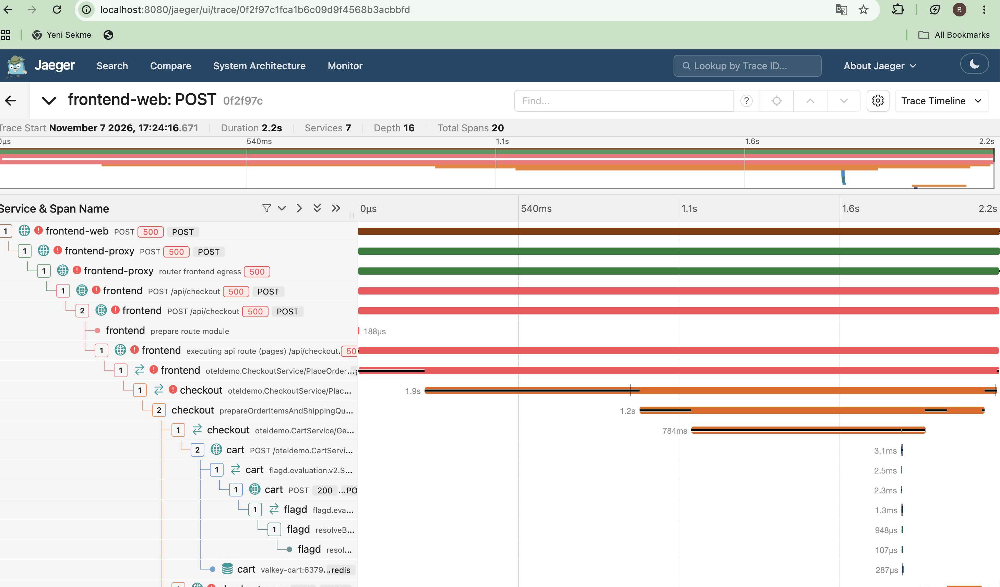

# FAILURE_INVESTIGATION.md — Bölüm D Raporu

Bu doküman, OpenTelemetry Astronomy Shop demo ortamında kontrollü olarak oluşturulan checkout hatasının incelenmesini açıklar.

Hata senaryosu, `http://localhost:8080/feature` adresindeki Feature Flag paneli kullanılarak oluşturulmuştur. İnceleme sırasında `paymentUnreachable` ayarı **On**, `paymentFailure` oranı ise **%100** olarak ayarlanmıştır.

---

## 1. Belirti (Symptom)

Sepet onaylanıp **Place Order** butonuna tıklandığında checkout işlemi normal şekilde tamamlanmamıştır.

İnceleme sırasında:

- Tarayıcının Network sekmesinde `/api/checkout` isteği beklemede kalmış ve `504 Gateway Timeout` yanıtıyla sonuçlanmıştır.
- UI tarafında kullanıcıya yeterince açık bir hata geri bildirimi gösterilmediği gözlemlenmiştir.

Bu bulgular, incelenen test çalıştırmasına ve kullanılan ortam konfigürasyonuna aittir.

## 2. İlk Hipotezler

1. **Hipotez A — Genel ağ veya servis bağlantısı:** Frontend ile checkout servisi arasındaki bağlantıda genel bir iletişim problemi yaşanmış olabilir.
2. **Hipotez B — Payment bağımlılığı:** Feature Flag ayarları nedeniyle CheckoutService'in PaymentService çağrısı başarısız olmuş veya zaman aşımına uğramış olabilir.
3. **Hipotez C — Frontend hata geri bildirimi:** Upstream servis hatası frontend tarafından kullanıcıya yeterince açık yansıtılmamış olabilir.

## 3. Kanıtlar

### 3.1 Network İncelemesi

Tarayıcının Network sekmesinde `/api/checkout` isteğinin `504 Gateway Timeout` yanıtıyla tamamlandığı gözlemlenmiştir.

Bu bulgu checkout isteğinin beklenen başarılı yanıtı alamadığını göstermektedir.

### 3.2 Jaeger Trace İncelemesi

- **Trace ID:** `0f2f97c1fca1b6c09d9f4568b3acbbfd`
- Trace üzerinde checkout akışındaki servis çağrıları incelenmiştir.
- PaymentService yönündeki çağrıda hata durumu ve `DEADLINE_EXCEEDED` / `UNAVAILABLE` bilgisi gözlemlenmiştir.



### 3.3 Backend Log İncelemesi

Checkout servisi loglarında aşağıdaki hata mesajı görülmüştür:

```text
[CheckoutService] Error calling PaymentService: grpc: deadline exceeded
```

Bu mesaj, CheckoutService'in PaymentService çağrısının zaman aşımına uğradığını göstermektedir.

### 3.4 Feature Flag Konfigürasyonu

Kontrollü hata senaryosu için Feature Flag panelinde şu ayarlar kullanılmıştır:

- **Panel:** `http://localhost:8080/feature`
- **paymentUnreachable:** On
- **paymentFailure:** %100

Bu konfigürasyon, ödeme bağımlılığı üzerinden başarısız checkout senaryosunu tetiklemek amacıyla kullanılmıştır.

## 4. Hipotezlerin Değerlendirilmesi

- **Hipotez A:** İsteğin checkout servisine ulaştığı ve trace üzerinde belirli bir downstream çağrıda hata görüldüğü için genel ağ kopukluğu tek başına yeterli bir açıklama değildir.
- **Hipotez B:** Feature Flag ayarları, PaymentService çağrısındaki hata ve backend logundaki `deadline exceeded` mesajı birlikte değerlendirildiğinde bu hipotez desteklenmektedir.
- **Hipotez C:** UI'da yeterince açık bir hata mesajı görülmemesi kullanıcı deneyimi açısından olumsuzdur. Bunun ürün gereksinimine aykırı bir defect olarak sınıflandırılması için beklenen hata davranışının ve tekrarlanabilirliğin ayrıca doğrulanması gerekir.

## 5. Sonuç / Root Cause

Bu kontrollü senaryoda checkout işleminin başarısız olması, ödeme bağımlılığı için etkinleştirilen hata konfigürasyonu ve PaymentService çağrısının zaman aşımına uğramasıyla ilişkilidir.

Network yanıtı, Jaeger trace ve backend log bulguları aynı hata akışını desteklemektedir.

Ayrıca frontend'in hata durumunda kullanıcıya yeterince açık geri bildirim vermediği gözlemlenmiştir. Bu konu, servis hatasının kendisinden ayrı bir kullanıcı deneyimi bulgusu olarak değerlendirilmelidir.

## 6. QA Kararı

**Karar:** Kontrollü downstream failure senaryosu tetiklenmiş ve servisler arası hata akışı trace ve log kayıtları üzerinden incelenmiştir.

Bu çalışma, üretim ortamında kendiliğinden meydana gelen bir servis arızasını değil, QA tarafından Feature Flag üzerinden oluşturulan kontrollü hata koşulunu temsil etmektedir. Sonuçlar bu test konfigürasyonuyla sınırlıdır.