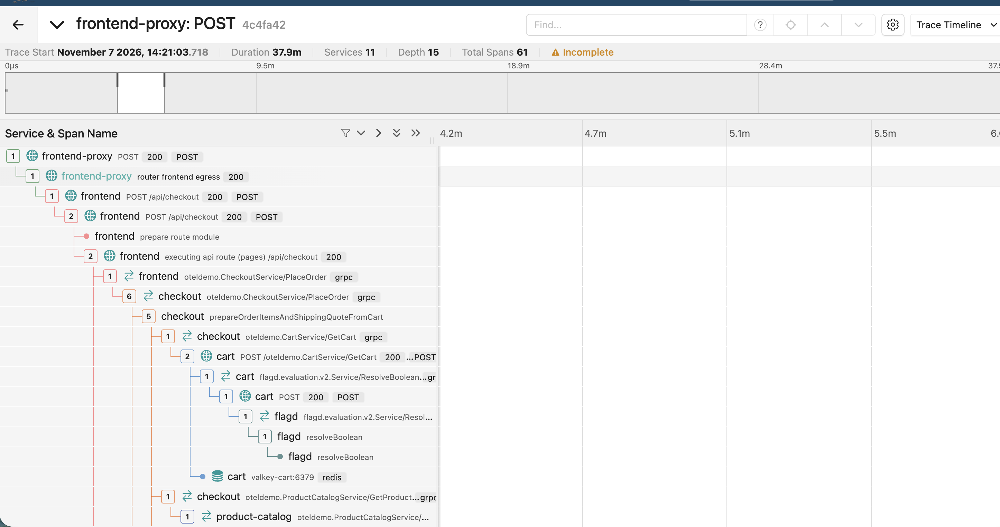
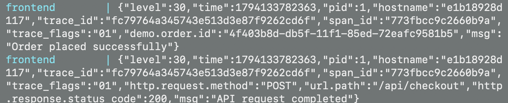

# BÖLÜM C: Observability Investigation (Trace, Log & Metric Analizi)

Bu dokümanda, OpenTelemetry Astronomy Shop demo ortamında gerçekleştirilen uçtan uca checkout (`UI-01`) senaryosunun dağıtık sistemler üzerindeki izleri (traces), logları ve metrikleri detaylıca analiz edilmiş ve somut kanıtlarla (evidence) desteklenmiştir.

---

## C1 — Distributed Tracing İncelemesi (Jaeger UI)

Playwright testi sırasında tetiklenen `POST /api/checkout` isteği Jaeger UI (`http://localhost:8080/jaeger/ui/`) üzerinden incelenmiştir.

1. **İstek Hangi Servislerden Geçti?**
   * İstek sırasıyla `frontend-web` (Nginx) -> `frontend-proxy` -> `frontend` (Next.js BFF) -> `checkout` (CheckoutService) -> `cart` (CartService) -> `flagd` (Feature Flag) ve `valkey-cart` (Redis) servislerinden geçmiştir.
2. **Hangi Servis Diğerini Çağırdı? (Servisler Arası İletişim)**
   * `frontend` katmanı gRPC protokolü üzerinden `checkout` servisini (`PlaceOrder`) tetikler. `checkout` servisi ise sepet doğrulaması için `cart` servisini, bayrak kontrolü için `flagd` servisini alt çağrılar (child spans) olarak tetikler.
3. **En Uzun Süren Adım Hangisiydi?**
   * Jaeger zaman çizelgesinde (timeline) orkestrasyonun ve veritabanı etkileşiminin yoğun olduğu `checkout` ile alt servislerin (`valkey-cart` / Redis) koşturulduğu adımlar toplam sürenin en büyük kısmını oluşturmuştur.
4. **Bir Servis Hata Verse Upstream / Downstream Nasıl Etkilenir?**
   * Alt seviyedeki `cart` veya `payment` servislerinden birinin hata dönmesi durumunda upstream'deki `checkout` servisi zaman aşımına uğrar ve bu durum `frontend` katmanına yansıyarak kullanıcı arayüzünde hata gösterilmesine neden olur.
5. **UI Sonucu ile Trace Uyumlu mu?**
   * **Evet, uyumludur.** Playwright testinde UI'da "Sipariş Başarılı" görülmüş, Jaeger'daki tüm span'ler HTTP 200 ve gRPC OK statüsüyle hatasız tamamlanmıştır.

---

## C2 — Log İncelemesi

1. **İlgili Log Örneği:**
   * `checkout` mikroservisinden/Next.js uygulamasından alınan başarılı sipariş kayıt ve HTTP yanıtı çıktıları:
     ```json
     {"level":30, "time":1794133325900, "demo.order.id":"3f209ae5-db5e-11f1-85ed-72eafc9581b5", "msg":"Order placed successfully"}
     {"level":30, "time":1794133325901, "http.request.method":"POST", "url.path":"/api/checkout", "http.response.status_code":200, "msg":"API request completed"}
     ```
2. **Servis ve Olay Detayı:** `checkout` konteynerinden gelmektedir ve siparişin işlenerek başarıyla kuyruğa/veritabanına kaydedildiğini onaylar.
3. **Sağladığı Ek Bilgi:** UI ekranında kullanıcıya gösterilen sipariş numarasının (`3f209ae5-...`), backend servisleri tarafından da eksiksiz üretilip işlendiğini teknik olarak doğrular.
4. **Kanıt Durumu:** UI üzerindeki başarı bildiriminin arka plandaki sistem iş kurallarıyla (`HTTP 200 OK`) birebir uyuştuğunu kanıtlar.

---

### C3 — Grafana / Prometheus Metrik İncelemesi

Bu bölümde, UI-01 başarılı checkout senaryosundan sonra metriklerin Prometheus üzerinden sorgulanıp sorgulanamadığı ve Grafana'da görüntülenip görüntülenemediği incelenmiştir.

#### 1. Grafana Data Source Kontrolü

Grafana'da Prometheus data source bağlantısı test edildiğinde aşağıdaki sonuç alınmıştır:

```text
Successfully queried the Prometheus API.
```

Bu sonuç, Grafana'nın Prometheus API'sine erişebildiğini göstermektedir. Ancak tek başına Prometheus üzerinde metrik verisi bulunduğunu kanıtlamaz.

#### 2. Prometheus `up` Sorgusu

Önce Prometheus üzerinde aşağıdaki sorgu çalıştırılmıştır:

```promql
up
```

Sorgu sonucunda:

```text
Empty query result
```

yanıtı alınmıştır.

Aynı sorgu Grafana Explore ekranında da çalıştırılmış ve **No data** sonucu görülmüştür.

Bu nedenle mevcut incelemede `up` metriği üzerinden servislerin scrape durumları doğrulanamamıştır.

#### 3. Prometheus Targets Kontrolü

Prometheus arayüzündeki Targets bölümünde şu mesaj görüntülenmiştir:

```text
No scrape pools found
```

Bu sonuç, Prometheus tarafında scrape edilecek hedef havuzlarının bulunmadığını göstermektedir.

Ancak OpenTelemetry Demo ortamında metrikler yalnızca Prometheus'un klasik scrape mekanizmasıyla aktarılmayabilir. Prometheus'un OTLP receiver üzerinden metrik kabul etmesi de mümkündür. Bu nedenle `No scrape pools found` mesajı tek başına metrik aktarımının tamamen çalışmadığını kanıtlamaz.

#### 4. Sonraki Kontrol: Metrik İsimlerini Sorgulama

Prometheus üzerinde yalnızca `up` metriğine bakmak yerine, herhangi bir metrik serisinin bulunup bulunmadığını kontrol etmek için aşağıdaki PromQL sorgusu kullanılmalıdır:

```promql
count by (__name__) ({__name__=~".+"})
```

Bu sorgu, Prometheus'ta bulunan metrik isimlerini ve her isim için mevcut seri sayısını listeler.

- Sonuç dönerse Prometheus'ta metrik verisi bulunmaktadır; `up` metriğinin bulunmaması, klasik scrape tabanlı izleme yapılmadığı anlamına gelebilir.
- Sonuç dönmezse Prometheus'ta sorgulanabilir metrik serisi bulunmadığı anlaşılır. Bu durumda OpenTelemetry Collector ile Prometheus arasındaki metrik aktarımının ayrıca incelenmesi gerekir.

#### 5. Gözlem ve Sonuç

Bu inceleme sırasında:

- Grafana'nın Prometheus API'sine erişebildiği doğrulanmıştır.
- Prometheus üzerinde `up` sorgusu boş sonuç döndürmüştür.
- Grafana Explore ekranında `up` sorgusu için **No data** görüntülenmiştir.
- Prometheus Targets bölümünde **No scrape pools found** mesajı görülmüştür.

Mevcut kanıtlarla checkout işlemi için latency, request rate, error rate veya servis bazında metrik değerleri raporlanamamaktadır. Bu nedenle başarılı checkout senaryosunun metrikler üzerindeki etkisi henüz doğrulanamamıştır.

**QA değerlendirmesi:** Trace ve log incelemesi checkout akışının izlenmesine yardımcı olurken, metrik incelemesi mevcut ortamda tamamlanamamıştır. Metrik verisi elde edilmeden performans veya sistem sağlığı hakkında sayısal bir sonuca varılmamıştır.


---

## C4 — Observability Evidence (Kanıtlar)

### 1. Distributed Trace Kanıtı
* **Trace ID:** `015e512ba706ea76f2cb4b99d76bcb79`
* **Görsel Kanıt:**



> *Açıklama: Yukarıdaki ekran görüntüsünde UI-01 testinin tetiklediği parent-child span ağacı, HTTP status 200/OK değerleri ve gRPC çağrıları görünmektedir.*

---

### 2. Backend Log Kanıtı
* **Konteyner:** `opentelemetry-demo-checkout`
* **Log Çıktısı:**
