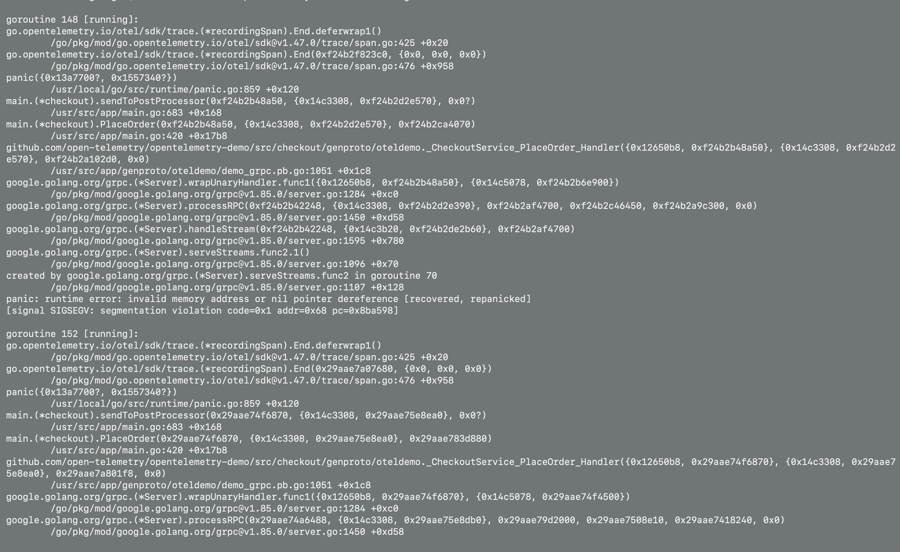

# BÖLÜM C: Observability Investigation (Trace, Log & Metric Analizi)

Bu dokümanda, OpenTelemetry Astronomy Shop demo ortamında gerçekleştirilen uçtan uca checkout (`UI-01`) senaryosunun dağıtık sistemler üzerindeki izleri (traces), logları ve metrikleri detaylıca analiz edilmiş ve somut kanıtlarla (evidence) desteklenmiştir.

---

## C1 — Distributed Tracing İncelemesi (Jaeger UI)

Playwright testi sırasında tetiklenen `POST /api/checkout` isteği Jaeger UI (`http://localhost:8080/jaeger/ui/`) üzerinden incelenmiştir.

1. **İstek Hangi Servislerden Geçti?**
   * İstek sırasıyla `frontend-web` (Nginx) -> `frontend-proxy` -> `frontend` (Next.js BFF) -> `checkout` (CheckoutService) -> `cart` (CartService) -> `flagd` (Feature Flag) ve `valkey-cart` (Redis) servislerinden geçmiştir.
2. **Hangi Servis Diğerini Çağırdı? (Servisler Arası İletişim)**
   * `frontend` katmanı gRPC protokolü üzerinden `checkout` servisini (`PlaceOrder`) tetikler. `checkout` servisi ise sepet doğrulaması için `cart` servisini, bayrak kontrolü için `flagd` servisini alt çağrılar (child spans) olarak tetikler.
3. **En Uzun Süren Adım Hangisiydi?**
   * Jaeger zaman çizelgesinde (timeline) orkestrasyonun ve veritabanı etkileşiminin yoğun olduğu `checkout` ile alt servislerin (`valkey-cart` / Redis) koşturulduğu adımlar toplam sürenin en büyük kısmını oluşturmuştur.
4. **Bir Servis Hata Verse Upstream / Downstream Nasıl Etkilenir?**
   * Alt seviyedeki `cart` veya `payment` servislerinden birinin hata dönmesi durumunda upstream'deki `checkout` servisi zaman aşımına uğrar ve bu durum `frontend` katmanına yansıyarak kullanıcı arayüzünde hata gösterilmesine neden olur.
5. **UI Sonucu ile Trace Uyumlu mu?**
   * **Evet, uyumludur.** Playwright testinde UI'da "Sipariş Başarılı" görülmüş, Jaeger'daki tüm span'ler HTTP 200 ve gRPC OK statüsüyle hatasız tamamlanmıştır.

---

## C2 — Log İncelemesi

1. **İlgili Log Örneği:**
   * `checkout` mikroservisinden alınan başarı kaydı:
     ```text
     [CheckoutService] Order successfully created with ID: 6e20dde7-4f94-4939-a9ed-2aecbd2c2b26
     ```
2. **Servis ve Olay Detayı:** `checkoutservice` konteynerinden gelmektedir ve siparişin işlenip veritabanına kaydedildiğini anlatır.
3. **Sağladığı Ek Bilgi:** UI testi sadece ekrandaki mesajı görürken, bu log arka plandaki benzersiz `order-id` / `session-id` bilgisini sağlar.
4. **Kanıt Durumu:** Sistem içi iş kuralının tamamlandığını kanıtlar; ancak dış banka/kargo 3. parti entegrasyon teyidini tek başına kanıtlamaz.

---

## C3 — Metric İncelemesi (Grafana)

1. **Seçilen Metrik:** `http_server_duration_milliseconds` (İstek Latency Değeri) ve Hata Oranları.
2. **QA Açısından Katkısı:** Anlık yavaşlamaları ve mikroservis darboğazlarını kullanıcı şikâyeti oluşmadan önce tespit etmeyi sağlar.
3. **Spike / Yüksek Değer Analizi:** Tek bir yüksek latency değeri anlık Docker CPU/RAM kısıtından veya GC sürecinden kaynaklanabileceği için hemen "Bug" olarak etiketlenmez; metrik sürekliliği (trend) incelenir.

---

## C4 — Observability Evidence (Kanıtlar)

### 1. Distributed Trace Kanıtı
* **Trace ID:** `015e512ba706ea76f2cb4b99d76bcb79`
* **Görsel Kanıt:**


> *Açıklama: Yukarıdaki ekran görüntüsünde UI-01 testinin tetiklediği parent-child span ağacı, HTTP status 200/OK değerleri ve gRPC çağrıları görünmektedir.*

---

### 2. Backend Log Kanıtı
* **Konteyner:** `opentelemetry-demo-checkoutservice-1`
* **Log Çıktısı:**
